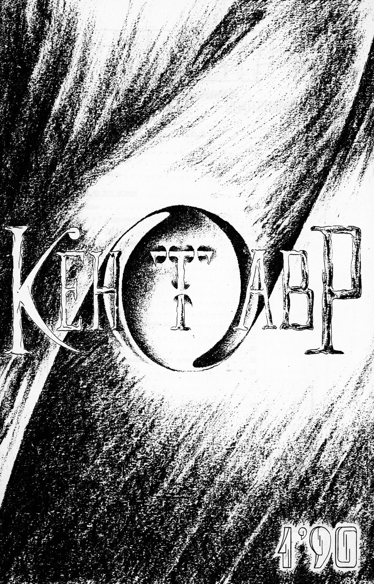

<div align="center">

# 📖 Kentavr · Кентавр


**A digital archive of the Russian methodological and game-practice almanac Kentavr (1990–2007).**

</div>

> Read the almanac as searchable text, then return to the scanned pages to check wording, layout and illustrations.

<div align="center">
  <a href="kentavr_1990_1/k_1990_1-0000.jpg"></a>
  <br><br>
  <a href="#concept">Concept</a> · <a href="#features">Features</a> · <a href="#quick-start">Quick Start</a> · <a href="#catalog">Issue Catalog</a> · <a href="#tech-stack">Tech Stack</a> · <a href="#roadmap">Roadmap</a> · <a href="#license">License</a> · <a href="#acknowledgements">Acknowledgements</a>
</div>

---

<a id="concept"></a>
## 💡 Concept

**Kentavr (Кентавр)** is a Russian-language methodological and game-practice almanac associated with the Moscow Methodological Circle (MMK) and the system–thought–activity (SMD) tradition. Its contents include methodological essays, interviews, discussions of organizational-activity games (ODI), education, science, law, consulting and social change.

This archive is for readers and researchers who need both searchable text and the appearance of the printed source.

> [!NOTE]
> The repository contains **40 issue scan folders**, **2,819 JPG files** and **40 Markdown issue texts**, covering the years 1990–2007.

---

<a id="features"></a>
## ✨ Features

| Feature | Description |
|---------|-------------|
| Original page images | Numbered JPG files preserve printed pages, covers and visual material. |
| Searchable Russian texts | One Markdown file per transcribed issue in [`md/`](md/). |
| Page references | HTML comments such as `<!-- page: 1 -->` preserve page labels in the Markdown source. |
| Issue metadata | YAML fields for `title`, `year`, `issue` and `source` at the beginning of each text. |
| Chronological catalog | Direct links to every scan folder and every available text, with JPG file counts. |
| LLM-readable documentation | [`llms.txt`](llms.txt) provides a short project card; [`llms-full.txt`](llms-full.txt) provides the detailed archive reference. |

<details>
<summary>📚 Examples from the archive</summary>

| Issue | Examples from its contents |
|-------|----------------------------|
| [1994 No. 2](md/kentavr_1994_2.md) | An issue dedicated to the memory of Georgy Petrovich Shchedrovitsky. |
| [1995 No. 2](md/kentavr_1995_2.md) | Organizational-activity games in education; simulation and role-playing games; philosophy of play. |
| [2000 No. 24](md/kentavr_2000_24.md) | Reflection as a cultural-historical and psychological phenomenon; ontology; methodology of science. |
| [2005 No. 36](md/kentavr_2005_36.md) | Methodology and freedom; thought–activity epistemology; qualifications, competencies and experience. |
| [2007 No. 40](md/kentavr_2007_40.md) | Horizons of methodology; the concept of history in Shchedrovitsky's work; thinking and understanding. |

These examples describe the source contents, not newly added interpretations or English translations.

</details>

---

<a id="quick-start"></a>
## 🚀 Quick Start

**Read on GitHub:** open [1990 No. 2 in Markdown](md/kentavr_1990_2.md) or browse its [scan folder](kentavr_1990_2/). The [catalog below](#catalog) links to the rest of the archive.

**Download the text collection with Git:**

```bash
git clone --depth=1 --filter=blob:none --sparse https://github.com/maximosovsky/kentavr.git
cd kentavr
git sparse-checkout set md
```

Open a file in `md/` with a Markdown viewer or text editor. GitHub access is required while the repository is private.

<details>
<summary>🖼️ Include scans or download the entire archive</summary>

To include a specific issue's scans in a sparse checkout:

```bash
git sparse-checkout set md kentavr_1990_2
```

To expand an existing sparse checkout to all files:

```bash
git sparse-checkout disable
```

A conventional full clone is also possible:

```bash
git clone https://github.com/maximosovsky/kentavr.git
```

Downloading all scans transfers substantially more data than downloading the text collection alone.

</details>

> [!TIP]
> Search across `md/` in a text editor to find names or concepts. Use source/raw view to see the `<!-- page: ... -->` markers: they are hidden in rendered Markdown. Check important quotations against the corresponding scan, not against a guessed image filename.

---

<a id="catalog"></a>
## 🗂️ Issue Catalog

Issue numbers follow the folder names exactly: annual numbering in the early years, followed by running numbers from 1997. A JPG file may be a cover, a printed page or an additional image; the last column is not a printed-page count.

<details>
<summary>📑 All 40 scan sets · 40 available texts · 2,819 JPG files</summary>

| Year | Issue | Page images | Markdown | JPG files |
|------|-------|-------------|----------|-----------|
| 1990 | No. 1 | [Scans](kentavr_1990_1/) | [Read text](md/kentavr_1990_1.md) | 74 |
| 1990 | No. 2 | [Scans](kentavr_1990_2/) | [Read text](md/kentavr_1990_2.md) | 93 |
| 1991 | No. 1 | [Scans](kentavr_1991_1/) | [Read text](md/kentavr_1991_1.md) | 60 |
| 1991 | No. 2 | [Scans](kentavr_1991_2/) | [Read text](md/kentavr_1991_2.md) | 59 |
| 1992 | No. 1 | [Scans](kentavr_1992_1/) | [Read text](md/kentavr_1992_1.md) | 60 |
| 1992 | No. 2 | [Scans](kentavr_1992_2/) | [Read text](md/kentavr_1992_2.md) | 59 |
| 1992 | No. 3 | [Scans](kentavr_1992_3/) | [Read text](md/kentavr_1992_3.md) | 60 |
| 1993 | No. 1 | [Scans](kentavr_1993_1/) | [Read text](md/kentavr_1993_1.md) | 60 |
| 1993 | No. 2 | [Scans](kentavr_1993_2/) | [Read text](md/kentavr_1993_2.md) | 60 |
| 1994 | No. 1 | [Scans](kentavr_1994_1/) | [Read text](md/kentavr_1994_1.md) | 69 |
| 1994 | No. 2 | [Scans](kentavr_1994_2/) | [Read text](md/kentavr_1994_2.md) | 64 |
| 1994 | No. 3 | [Scans](kentavr_1994_3/) | [Read text](md/kentavr_1994_3.md) | 59 |
| 1995 | No. 1 | [Scans](kentavr_1995_1/) | [Read text](md/kentavr_1995_1.md) | 64 |
| 1995 | No. 2 | [Scans](kentavr_1995_2/) | [Read text](md/kentavr_1995_2.md) | 64 |
| 1996 | No. 1 | [Scans](kentavr_1996_1/) | [Read text](md/kentavr_1996_1.md) | 60 |
| 1996 | No. 2 | [Scans](kentavr_1996_2/) | [Read text](md/kentavr_1996_2.md) | 64 |
| 1997 | No. 17 | [Scans](kentavr_1997_17/) | [Read text](md/kentavr_1997_17.md) | 64 |
| 1997 | No. 18 | [Scans](kentavr_1997_18/) | [Read text](md/kentavr_1997_18.md) | 68 |
| 1998 | No. 19 | [Scans](kentavr_1998_19/) | [Read text](md/kentavr_1998_19.md) | 68 |
| 1998 | No. 20 | [Scans](kentavr_1998_20/) | [Read text](md/kentavr_1998_20.md) | 68 |
| 1999 | No. 21 | [Scans](kentavr_1999_21/) | [Read text](md/kentavr_1999_21.md) | 68 |
| 2000 | No. 22 | [Scans](kentavr_2000_22/) | [Read text](md/kentavr_2000_22.md) | 60 |
| 2000 | No. 23 | [Scans](kentavr_2000_23/) | [Read text](md/kentavr_2000_23.md) | 68 |
| 2000 | No. 24 | [Scans](kentavr_2000_24/) | [Read text](md/kentavr_2000_24.md) | 68 |
| 2001 | No. 25 | [Scans](kentavr_2001_25/) | [Read text](md/kentavr_2001_25.md) | 72 |
| 2001 | No. 26 | [Scans](kentavr_2001_26/) | [Read text](md/kentavr_2001_26.md) | 68 |
| 2001 | No. 27 | [Scans](kentavr_2001_27/) | [Read text](md/kentavr_2001_27.md) | 72 |
| 2002 | No. 28 | [Scans](kentavr_2002_28/) | [Read text](md/kentavr_2002_28.md) | 76 |
| 2002 | No. 29 | [Scans](kentavr_2002_29/) | [Read text](md/kentavr_2002_29.md) | 72 |
| 2002 | No. 30 | [Scans](kentavr_2002_30/) | [Read text](md/kentavr_2002_30.md) | 72 |
| 2003 | No. 31 | [Scans](kentavr_2003_31/) | [Read text](md/kentavr_2003_31.md) | 72 |
| 2003 | No. 32 | [Scans](kentavr_2003_32/) | [Read text](md/kentavr_2003_32.md) | 74 |
| 2004 | No. 33 | [Scans](kentavr_2004_33/) | [Read text](md/kentavr_2004_33.md) | 76 |
| 2004 | No. 34 | [Scans](kentavr_2004_34/) | [Read text](md/kentavr_2004_34.md) | 76 |
| 2005 | No. 35 | [Scans](kentavr_2005_35/) | [Read text](md/kentavr_2005_35.md) | 75 |
| 2005 | No. 36 | [Scans](kentavr_2005_36/) | [Read text](md/kentavr_2005_36.md) | 80 |
| 2005 | No. 37 | [Scans](kentavr_2005_37/) | [Read text](md/kentavr_2005_37.md) | 80 |
| 2006 | No. 38 | [Scans](kentavr_2006_38/) | [Read text](md/kentavr_2006_38.md) | 83 |
| 2006 | No. 39 | [Scans](kentavr_2006_39/) | [Read text](md/kentavr_2006_39.md) | 88 |
| 2007 | No. 40 | [Scans](kentavr_2007_40/) | [Read text](md/kentavr_2007_40.md) | 122 |

</details>

---

<a id="tech-stack"></a>
## 🏗️ Tech Stack

| Layer | Format / Tool |
|-------|---------------|
| Page images | JPG |
| Issue texts | UTF-8 Markdown in Russian |
| Issue metadata | YAML front matter |
| Page labels | HTML comments in the Markdown source |
| Storage and history | Git / GitHub |
| Reading | GitHub, a Markdown viewer or a text editor |

<details>
<summary>📁 Repository structure and naming</summary>

```text
kentavr/
|-- kentavr_1990_1/          # Scans and a corresponding text in md/
|   |-- k_YYYY_N-0000.jpg
|   |-- k_YYYY_N-0000_a.jpg
|   `-- ...
|-- kentavr_1990_2/          # Scans with a corresponding text in md/
|   |-- k_YYYY_N-0000.jpg
|   |-- 0001.jpg
|   `-- ...
|-- ...                     # Other issue scan folders
|-- kentavr_2007_40/
|-- md/                     # 40 issue texts
|   |-- kentavr_1990_2.md
|   |-- kentavr_1991_1.md
|   `-- ...
|-- llms.txt
|-- llms-full.txt
`-- README.md
```

- Scan folder: `kentavr_YEAR_ISSUE/`.
- Text file: `md/kentavr_YEAR_ISSUE.md`.
- Image filenames use four-digit numbers in older folders and `page-NN` names in newer ones; some have suffixes such as `_a` or `_b`. Preserve those names when citing or correcting the archive.
- The front-matter value `source: pages-o.html` is provenance metadata. No `pages-o.html` file is currently included in this repository.
- Page comments retain source labels, including cover labels. They do not guarantee a one-to-one mapping to JPG filenames.

</details>

---

<a id="roadmap"></a>
## 🗺️ Roadmap

- [x] 40 issue scan sets from 1990–2007.
- [x] 40 Markdown issue texts with metadata and page comments.
- [x] A linked issue catalog and LLM-readable project documentation.

---

<a id="contributing"></a>
## 🤝 Contributing

Fork → `fix/issue-description` → Pull Request.

For a text correction, identify the issue, the `<!-- page: ... -->` label and the corresponding scan. Keep the Russian wording and source references intact; distinguish a transcription correction from an editorial change. New scans should retain the existing year/issue folder convention.

Do not silently renumber images or overwrite source material to make the catalog appear complete. If a missing issue is supplied, include its provenance and update the catalog and both LLM reference files.

---

<a id="license"></a>
## 📄 License

Maintained by [Maxim Osovsky](https://www.linkedin.com/in/osovsky/). Licensed under [CC BY-SA 4.0](https://creativecommons.org/licenses/by-sa/4.0/).

---

<a id="acknowledgements"></a>
## 🙏 Acknowledgements

Our deep gratitude to V. M. Busev, founder of the [Electronic Library "Mathematical Education"](https://www.mathedu.ru/) (2018), for invaluable help with scanning, text recognition, hosting and support of the project.
